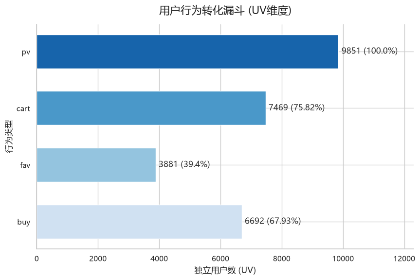

# 淘宝用户行为数据分析：电商转化与留存洞察

## 1. 项目背景与目标

本项目基于阿里天池公开的淘宝用户行为数据集（原始数据约 1.0015 亿条），使用 MySQL 和 Python 对用户行为进行清洗、统计与可视化分析。项目围绕用户行为分布、探索性转化漏斗、行为路径转移、Cohort 活跃留存以及用户生命周期展开，旨在识别样本中的主要行为特征，为电商平台的用户运营与产品体验优化提供数据参考。

### 📌 项目概览
- **数据规模**：抽取约 100.2 万条行为记录，覆盖 9,895 名用户。
- **观察窗口**：2017 年 11 月 25 日 至 2017 年 12 月 3 日（共 9 天）。
- **分析模块**：数据清洗、UV 转化漏斗、相邻行为转移、Cohort 留存、生命周期与回访间隔。
- **核心工具**：MySQL 8.0、Python (Pandas, Seaborn)、Jupyter Notebook。
- **项目价值**：从行为分布、相邻事件转移和 Cohort 留存等角度探索用户特征，并明确区分数据现象与业务假设。

## 2. 数据与工具

- **数据来源**：阿里天池 UserBehavior 数据集。
- **抽样方式**：基于 `user_id % 100 = 0` 筛选用户。该方法保留入选用户在原始数据中的行为记录，但不应直接视为严格随机抽样。结论主要反映该样本在观察窗口内的特征。
- **技术栈**：
  - 数据库：MySQL 8.0
  - 数据处理：Python、Pandas、NumPy
  - 数据可视化：Matplotlib、Seaborn
  - 分析环境：Jupyter Notebook、Git

## 3. 分析模块与目录结构

项目按照数据处理、行为分析、留存分析的顺序组织：
1. **数据清洗与时间维度处理**：检查数据完整性，筛选分析窗口，提取时间维度。
2. **用户行为分布与漏斗探索**：基于独立用户数（UV）比较浏览、加购、收藏和购买行为的覆盖情况。
3. **用户行为路径转移**：使用 `LAG()` 识别相邻行为事件之间的转移，通过热力图观察流转特征。
4. **同期群活跃留存分析（Cohort）**：计算各 Cohort 的活跃留存率，并进行小样本筛选与未观测周期屏蔽。
5. **用户生命周期与回访间隔分析**：统计观察窗口内用户的活跃跨度与回访间隔分布。

### 目录结构

text
项目根目录/
├── data/                  # 聚合结果或抽样数据（按需提供）
├── images/                # README 中展示的图表截图
├── sql/                   # 建表、抽样、清洗及分析 SQL 脚本
├── notebooks/             # Jupyter Notebook 分析文件
├── .env.example           # 环境变量配置模板
├── .gitignore             # Git 忽略规则
├── requirements.txt       # Python 依赖
└── README.md              # 项目说明

4. 核心发现
### 发现一：全站行为漏斗与用户次日留存表现
 **数据证据（漏斗）**：从全量清洗数据来看，独立用户漏斗呈现 `pv`(9,851) -> `cart`(7,469) -> `buy`(6,692) 的转化路径。
 **数据证据（留存）**：以 2017-11-25 为首日活跃的 Cohort，其 Day 1 留存率为 79.55%。
 **统计口径**：漏斗基于独立用户数（UV）；留存以 Day 0 UV 为分母，剔除样本量小于 300 的 Cohort，屏蔽未观测周期。
 **业务解释与局限**：样本用户表现出极高的活跃度与购买意向。但仅反映特定观察窗口，不能代表全量平台用户的长期留存。
 **后续验证方向**：可观察其他满足样本量条件的 Cohort，观察其留存是否相近（需确保计算口径一致）。

*(图：全量用户 UV 漏斗)*
### 发现二：加购后再次浏览现象值得关注
**数据证据**：在观测窗口内，发生 cart -> pv 相邻行为转移的独立用户数为 5,677 人。

**统计口径**：统计至少发生过一次该类相邻行为转移的独立用户数（UV）。

**业务解释与局限**：加购后再次浏览可能反映用户正在比较商品，或将购物车作为暂存区使用。该行为不能直接等同于购物车流失。

**后续验证方向**：进一步观察这批用户后续是否购买、多久购买，以及是否存在不同的回访模式。

(图：用户行为转移热力图)

### 发现三：样本中存在不同类型的购买前相邻行为转移
**数据证据**：发生 pv -> buy 相邻行为转移的独立用户数为 4,515 人，高于发生 cart -> buy 相邻行为转移的独立用户数（1,139 人）。

**统计口径**：统计观测窗口内至少发生过一次相应相邻行为转移的独立用户数（UV）。

**业务解释与局限**：该结果反映了样本中的相邻行为转移特征，不代表互斥购买路径的占比，也不能直接推断用户的消费心理。

**后续验证方向**：后续可按商品、用户或行为序列进行细分，验证不同转移模式是否表现出不同的购买特征。

!(images/funnel.png)
(图：探索性转化漏斗)

### 发现四：2017年11月25日 Cohort 的次日活跃留存表现较高
**数据证据**：以 2017 年 11 月 25 日为首次活跃日期的 Cohort，其 Day 1 留存率为 79.55%。

**统计口径**：以 Day 0 UV 为分母计算后续周期的活跃留存率；剔除样本量小于 300 的 Cohort，并屏蔽尚未完整观测的周期。

**业务解释与局限**：该 Cohort 在次日表现出较高的活跃留存，但仅反映特定样本和观察窗口内的活跃情况，不能直接代表全量平台用户的长期留存。

**后续验证方向**：可观察其他满足样本量条件的 Cohort，其次日留存是否也处于相近水平（需确保计算口径一致）。

!(images/cohort.png)
(图：清洗后的 Cohort 留存矩阵)

5. 如何运行
环境要求
MySQL 8.0+

Python 3.10+

Git（用于克隆仓库及版本管理）
(建议使用独立 Python 虚拟环境，安装依赖：pip install -r requirements.txt)

数据准备
从阿里天池获取原始 UserBehavior.csv 数据集，放置在项目外的安全目录（或自行调整导入路径）。

执行 sql/01_create_raw_table.sql 创建原始数据表。

配置 MySQL 本地文件导入权限，使用 LOAD DATA LOCAL INFILE 导入数据。

按顺序执行 sql/ 目录下的脚本：02_create_sample_table.sql、03_create_clean_table.sql 完成数据抽样与清洗。

数据库配置
复制 .env.example，创建本地 .env 文件。

在 .env 中填写本地数据库连接配置（用户名、密码等）。

确认 .env 已加入 .gitignore，不要将密码等敏感信息提交至版本库。

运行分析
安装依赖后，按以下顺序执行 notebooks/ 目录中的 Jupyter Notebook：

01_data_exploration.ipynb：数据清洗与时间维度处理。

02_funnel_analysis.ipynb：用户行为分布与漏斗探索。

03_cohort_analysis.ipynb：行为路径转移、留存及生命周期分析。
(运行前请确认 MySQL 服务已启动、目标数据库和数据表已创建。)

6. 注意事项与局限性
抽样局限：本项目基于 user_id % 100 = 0 筛选用户，不能保证样本严格随机，分析结果不应直接推广为全量平台结论。

观察窗口局限：数据分析仅覆盖 2017年11月25日至12月3日。生命周期跨度指观察窗口内首次活跃日至末次活跃日之间的时间差，不等于用户真实的完整生命周期。

漏斗口径：漏斗统计基于各行为类型的独立用户数，并未要求用户严格按照浏览、加购或收藏、购买的顺序完成全部步骤，因此属于探索性漏斗。

路径分析口径：行为转移基于相邻事件，不能完整还原用户的购买旅程，也不能单独用于判断购买意愿或流失原因。

留存分析局限：Cohort 留存结果受样本规模和观察窗口影响。尚未完整观测的周期不应被解释为零留存。

性能说明：当前分析以抽样数据为基础，处理全量数据前应评估数据库资源与查询性能。